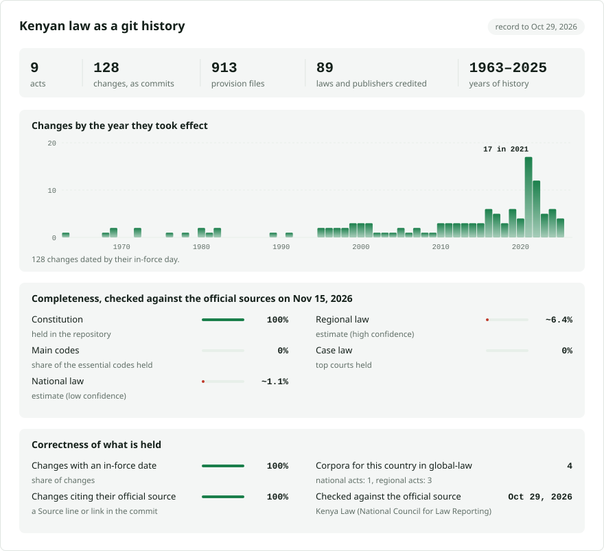

# Kenya: law history in git

<picture>
<source media="(prefers-color-scheme: dark)" srcset="data/effort-dark.svg">

</picture>

The law of Kenya as a git history: one file per section (or article or schedule), one commit per law on the day it took effect, and the law that made each change as the commit's author. `git blame` names the law behind every paragraph; `git log` lists every change to a section; picking a date gives the text in force that day.

Part of [lexifina/global-law](https://github.com/lexifina/global-law), one git history for every country's law: this is Kenya's national law, which global-law reads at `kenya/national/acts/`.

**What is in it now:** the Constitution of Kenya, 2010 and 8 Acts of Parliament (the Capital Markets, Tax Procedures, Kenya Revenue Authority, Excise Duty, Estate Duty, Independent Electoral and Boundaries Commission, Central Bank of Kenya and Alcoholic Drinks Control Acts), with 151 versions from 1963 to 2025, in 128 commits, 118 of them credited to 88 laws. Added on 2026-11-26 from secondary copies (FAOLEX and WIPO Lex; Kenya Law's own site was not used): 71 more consolidated laws as Kenya Law dated them (43 Acts, among them the Penal Code, the Criminal Procedure Code, the Evidence Act, the Civil Procedure Act and the Land Act 2012), 437 pieces of subsidiary legislation (`subsidiary/<year>/`), 199 Acts as made (`as-made/<year>/`), 680 commits in all, in force from 1915-06-17 to 2026-09-18. [`REPRODUCE.md`](REPRODUCE.md) lists every act with its versions; [`data/laws.csv`](data/laws.csv) lists every law with the day it took effect.

Each act is a folder with one file per provision, plus a `README.md` listing its provisions and their changes (`tax-procedures/sec-083.md` is section 83 of the Tax Procedures Act, No. 29 of 2015; `constitution/sec-001.md` is Article 1 of the Constitution).

The text is in English, as Kenya Law publishes it; Kenya Law's editorial notes are left out of it and used only to credit changes.

## Questions as git commands

| Question | Command |
| --- | --- |
| Every change to section 83 of the Tax Procedures Act | `git log -p --word-diff -- tax-procedures/sec-083.md` |
| Which law wrote each line of section 83? | `git blame tax-procedures/sec-083.md` |
| Every change to the Act, with the day each took effect and the law that made it | `git log --format="%h %(trailers:key=In-force,valueonly,separator=) %an" -- tax-procedures ':!*/README.md'` |
| Section 83 as it stood on 1 January 2020 | `python tools/on.py 2020-01-01 tax-procedures 83` |

**Outside git**, we also host this record publicly, for free:

- **[Ask Claude about Kenyan law](https://global-law.lexifina.com/v1/try_claude?country=kenya)**: opens Claude with a first question ready.
- **[Ask ChatGPT](https://global-law.lexifina.com/v1/try_chatgpt?country=kenya)**: the same question in ChatGPT.
- **[Search Kenyan law on our site](https://lexifina.com/law?country=kenya&q=late+submission)**: a search for "late submission", with each provision's text and its versions, no account needed.
- **[Developer REST API](https://global-law.lexifina.com/v1/search_law?query=late+submission&jurisdiction=kenya)**: the same search as JSON, with no key. See the [documentation here](https://lexifina.com/api/global-law).

Both assistants read the record through the free Global law connector (MCP, `https://global-law.lexifina.com/mcp`); the first time, the chat gives you the link that adds it. Ask in English.

**Host it yourself easily.** All it takes is git and Python, and the tools run on your machine:

```sh
git clone --depth 1 https://github.com/lexifina/global-law && cd global-law
python3 tools/countries.py add kenya/national/acts
python3 tools/law.py show 2026-01-01 kenya/national/acts/tax-procedures/sec-083.md
```

Opened in Claude Code, Cursor, VS Code or Codex, the clone also starts a local MCP server with the same tools ([MCP.md](https://github.com/lexifina/global-law/blob/main/MCP.md)).

## Dates

Each commit is dated at noon, Africa/Nairobi, on the day the change took effect, and carries it in its `In-force:` trailer; the days enacted and published are trailers too, where Kenya Law gives them:

- for a change, the date of Kenya Law's version that takes it in: the day the amending law came into force, as its amendment list gives it; for the revised edition of 2022-12-31 (the 24th Annual Supplement), that date;
- for the first version of an act, the commencement day Kenya Law states ("Commenced on 19 January 2016 by Tax Procedures Act Commencement"), or else the day it was published in the Gazette;
- git cannot store a date before 1970, so the 4 commits in force earlier (from 1963 to 1969) are dated 1 January 1970, with the real day in `In-force:`, which `tools/on.py` reads.

Each change is credited to the law Kenya Law's History names for it (`Act No. 9 of 2025`). Where one version takes in several laws, or is the revised edition, a provision is credited to a law only if Kenya Law's editorial note in it names that law; the rest are committed by the publisher (`Kenya Law (National Council for Law Reporting)`) as unexplained (9 commits). The first version is credited to the act as enacted, except the Central Bank of Kenya Act's, which is the oldest version available and is the publisher's.

## How it is checked

- `tools/check_repo.py` reads every version back from git on the day it took effect and on the day before, and compares it with the corpus it was built from: 151 versions of 9 acts, 0 mismatches (see [`REPRODUCE.md`](REPRODUCE.md)).
- Every version is parsed from an archived copy of exactly that Kenya Law version's page; `data/versions.json` gives its address and sha256.
- A second build from the same corpus gave identical hashes for all 128 commits and 232 tags.
- History is append-only: no merge commits, no commit dates going backwards, nothing dated after the build, and every commit's trailers parse.
- [vulnerabilities/](vulnerabilities/): possible drafting mistakes in this law, found by global-law's detectors and checked by hand. Not run yet.

## What it does not show

- **Most of Kenya's Acts.** Acts were taken only where every version Kenya Law lists has an archived copy; the Employment Act 2007, the Income Tax Act, the Value Added Tax Act 2013 and others are left out because a version is missing (`REPRODUCE.md` says which and why). The secondary copies added later give one version of each act, the one FAOLEX or WIPO Lex holds, not its earlier versions; revised editions dated only by a year, and scans without a text layer, are not here.
- **Changes before Kenya Law's oldest version** of an act are not separate commits.
- **Editorial notes and headings.** Kenya Law's bracketed notes are kept only where a provision has no other text (repealed or spent); Part, Chapter and Division headings are left out.
- **Most subsidiary legislation, and case law.** Subsidiary legislation is here only where FAOLEX or WIPO Lex holds a copy with a text layer and a day it was made; Supreme Court decisions are in a separate private repository.
- **Later versions.** Amendments Kenya Law has not yet applied to its text, and versions after the record was retrieved (2026-10-29), are not here; the latest version took effect on 2025-12-11.

## Sources

| Source | Kind | Past versions | Notes |
| --- | --- | --- | --- |
| [Kenya Law](https://new.kenyalaw.org) (National Council for Law Reporting) | Laws of Kenya, consolidated, on the Laws.Africa platform | yes, a dated version for each amendment | The text, the History and amendment list that date each version, and the editorial notes used for credits |
| [Internet Archive](https://web.archive.org/) | Archived copies of Kenya Law's pages | as archived | Every version is read from one |
| [FAOLEX](https://faolex.fao.org) (FAO) and [WIPO Lex](https://www.wipo.int/wipolex) (WIPO) | Copies of Kenya Law's PDFs (Kenya Law and Laws.Africa, CC BY-NC-SA 4.0) and of Acts and Legal Notices as made | one version each, as the copy holds it | Secondary copies: every such commit says so in `Source-status:` |

## Licence

See [`LICENSE`](LICENSE). Kenya Law's terms of use (s. 9) make its raw, unannotated source documents available under CC BY-NC 4.0, crediting the National Council for Law Reporting, and require a Licensing Agreement from it for automated extraction, commercial redistribution and AI training; the texts may be used only for non-commercial purposes. Lexifina's arrangement, commit messages, tables and tools are CC0 1.0.

No model wrote, translated or corrected legal text, and no model runs at build time; the scripts that read the sources and build this repository were written by an AI model (see [`REPRODUCE.md`](REPRODUCE.md)).

## Visualisations

- [visualisations/](visualisations/): charts drawn from this repository. Not drawn yet.

## More

From [lexifina/global-law](https://github.com/lexifina/global-law):

- [FEATURES.md](https://github.com/lexifina/global-law/blob/main/FEATURES.md): every feature, and what every corpus must support (`git blame`, `law.py`, the MCP tools)
- [FAQ.md](https://github.com/lexifina/global-law/blob/main/FAQ.md): questions and answers · [CONTRIBUTING.md](https://github.com/lexifina/global-law/blob/main/CONTRIBUTING.md): proposing changes · [MCP.md](https://github.com/lexifina/global-law/blob/main/MCP.md): the MCP server · [REPRODUCE.md](https://github.com/lexifina/global-law/blob/main/REPRODUCE.md): how it was built · [CHANGELOG.md](https://github.com/lexifina/global-law/blob/main/CHANGELOG.md)
- [FRESHNESS.md](https://github.com/lexifina/global-law/blob/main/FRESHNESS.md): how current each corpus is · [Monitoring](https://github.com/lexifina/global-law/tree/main/monitoring): whether updates are running · [WATCHING.md](https://github.com/lexifina/global-law/blob/main/WATCHING.md): how each official source is watched for changes
- [performance/](https://github.com/lexifina/global-law/tree/main/performance): how fast the tools are, measured
- [visualisations/](https://github.com/lexifina/global-law/tree/main/visualisations): charts and bridges across the world's law
- [Vulnerabilities](https://github.com/lexifina/global-law/tree/main/vulnerabilities): mistakes in legislation as published
